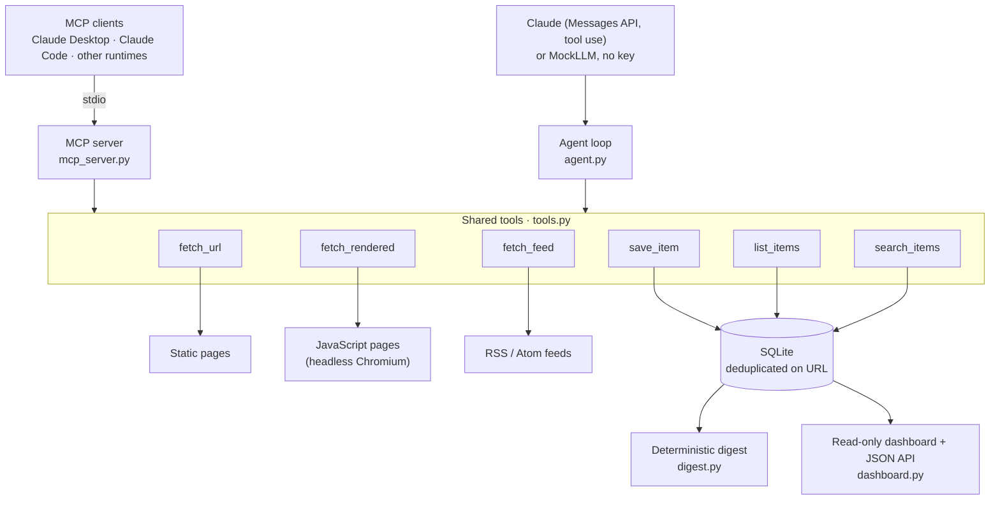
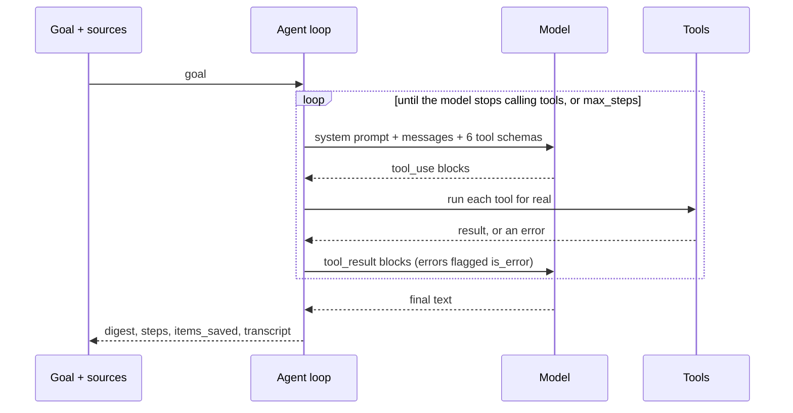

# MCP Research Agent

[](https://github.com/gbadedata/mcp-research-agent/actions/workflows/tests.yml)


**One toolset for collecting information from the web, served three ways: as an MCP server any
MCP client can plug into, as an autonomous Claude agent, and as a read-only dashboard.**

It reads web pages, JavaScript-heavy pages and RSS/Atom feeds, keeps the items worth keeping in a
deduplicated SQLite store, and turns them into a short digest. The tools are written once and shared,
so the MCP server, the agent and the dashboard cannot drift apart. The whole system runs and is tested
**without an API key**: a scripted mock model drives the real agent loop over real fetches and saves.

```text
$ python -m research_agent.cli demo
Agent finished in 3 steps, tool calls: ['fetch_url', 'save_item', 'save_item']

Research digest (2 of 2 items):

- MCP adoption grows [Sample Feed] More clients adopt the Model Context Protocol.
  https://example.com/mcp
- Anthropic ships new agent tooling [Sample Feed] New tooling for building agents.
  https://example.com/agents
```

<table>
<tr><td><b>6 tools</b></td><td>fetch a page, render a JavaScript page, read a feed, save, list, search</td></tr>
<tr><td><b>3 surfaces</b></td><td>MCP server (stdio) · Claude tool-use agent · FastAPI dashboard and JSON API</td></tr>
<tr><td><b>Offline by default</b></td><td>demo and test suite need no key and no network</td></tr>
<tr><td><b>Tested</b></td><td>19 tests plus a gated live-agent test, on Python 3.10, 3.11 and 3.12 in CI</td></tr>
</table>

---

## Contents

- [Quick start](#quick-start)
- [How it fits together](#how-it-fits-together)
- [The tools](#the-tools)
- [Use it from an MCP client](#use-it-from-an-mcp-client)
- [Run it as an autonomous agent](#run-it-as-an-autonomous-agent)
- [Browse what it collected](#browse-what-it-collected)
- [How the agent loop works](#how-the-agent-loop-works)
- [Reference](#reference)
- [Security and trust model](#security-and-trust-model)
- [Testing](#testing)
- [Extending it](#extending-it)
- [Design decisions](#design-decisions)
- [Limitations](#limitations)
- [Roadmap](#roadmap)
- [Project structure](#project-structure)

## Quick start

Python 3.10 or newer (the MCP SDK's minimum).

```bash
git clone https://github.com/gbadedata/mcp-research-agent && cd mcp-research-agent
python -m venv .venv && source .venv/bin/activate     # Windows: .venv\Scripts\activate
pip install -r requirements.txt

python -m research_agent.cli tools     # list the tools and their required inputs
python -m research_agent.cli demo      # the full agent loop, offline, no API key
python -m pytest -q                    # 19 passed, 1 skipped (the live test, without a key)
```

`fetch_rendered` needs a headless browser. It is optional; without it the tool returns a clear error
and everything else works.

```bash
pip install playwright && playwright install chromium
```

## How it fits together



Every tool is a plain Python function that returns a JSON-serialisable dict. The MCP server wraps
each one with `@mcp.tool()`, and the agent describes the same functions to the model as tool schemas.
Neither surface has its own implementation of anything.

| Module | Responsibility |
|---|---|
| [`tools.py`](research_agent/tools.py) | the six tools; HTML parsing shared by the static and rendered fetchers |
| [`store.py`](research_agent/store.py) | SQLite persistence: one table, unique on URL |
| [`mcp_server.py`](research_agent/mcp_server.py) | FastMCP server exposing the tools over stdio |
| [`agent.py`](research_agent/agent.py) | the tool-use loop, tool schemas and dispatch |
| [`llm.py`](research_agent/llm.py) | `AnthropicLLM` (Messages API) and `MockLLM` (scripted, no key) behind one `complete()` call |
| [`dashboard.py`](research_agent/dashboard.py) | read-only FastAPI app: an HTML page and a JSON API |
| [`digest.py`](research_agent/digest.py) | a digest built straight from the store, with no model call |
| [`cli.py`](research_agent/cli.py) | `demo`, `run`, `serve`, `dashboard`, `digest`, `tools`, `init-db` |

## The tools

| Tool | What it does | Inputs (required in bold) | Returns |
|---|---|---|---|
| `fetch_url` | fetches static HTML (http, https or `file://`), strips scripts and styles, collapses whitespace | **`url`**, `max_chars` = 2000 | `title`, `text`, up to 20 absolute `links`, HTTP `status` |
| `fetch_rendered` | the same, after a headless Chromium has run the page's JavaScript; use when `fetch_url` returns too little | **`url`**, `max_chars` = 2000 | as above, plus `rendered: true` |
| `fetch_feed` | parses an RSS or Atom feed | **`url`**, `limit` = 10 | `feed_title`, `count`, entries with `title`, `link`, `summary` (500 chars), `published` |
| `save_item` | stores an item; a URL already stored is ignored | **`source`**, **`title`**, **`url`**, `summary` | `saved`, `id`, `reason` (`stored` or `duplicate url`) |
| `list_items` | the most recently stored items | `limit` = 10 | `items`, `total` |
| `search_items` | case-insensitive keyword match on title or summary | **`query`**, `limit` = 10 | `query`, `items` |

## Use it from an MCP client

The server speaks MCP over stdio. Point your client at the project's virtual-environment Python, and
pass the repo path and database location through `env`, so the server starts correctly whatever
working directory the client launches it from.

**Claude Desktop** (`claude_desktop_config.json`):

```json
{
  "mcpServers": {
    "research-agent": {
      "command": "/absolute/path/to/mcp-research-agent/.venv/bin/python",
      "args": ["-m", "research_agent.mcp_server"],
      "env": {
        "PYTHONPATH": "/absolute/path/to/mcp-research-agent",
        "RESEARCH_DB": "/absolute/path/to/mcp-research-agent/research_agent.db"
      }
    }
  }
}
```

On Windows the interpreter is `.venv\Scripts\python.exe`. Restart Claude Desktop after editing.

**Claude Code:**

```bash
claude mcp add-json research-agent '{
  "type": "stdio",
  "command": "/absolute/path/to/mcp-research-agent/.venv/bin/python",
  "args": ["-m", "research_agent.mcp_server"],
  "env": {
    "PYTHONPATH": "/absolute/path/to/mcp-research-agent",
    "RESEARCH_DB": "/absolute/path/to/mcp-research-agent/research_agent.db"
  }
}'
```

Then ask in plain language, for example *"Read the feed at https://example.com/feed.xml, save the
three most relevant posts about agents, and give me a digest."* The client chooses which tools to call.

<details>
<summary><b>Check the server from Python, without a client app</b></summary>

```python
import asyncio, json, sys
from pathlib import Path
from mcp import ClientSession, StdioServerParameters
from mcp.client.stdio import stdio_client

FEED = Path("tests/fixtures/sample_feed.xml").resolve().as_uri()

async def main():
    params = StdioServerParameters(command=sys.executable, args=["-m", "research_agent.mcp_server"],
                                   env={"RESEARCH_DB": ":memory:"})
    async with stdio_client(params) as (read, write):
        async with ClientSession(read, write) as session:
            await session.initialize()
            print(sorted(t.name for t in (await session.list_tools()).tools))
            feed = await session.call_tool("fetch_feed", {"url": FEED})
            print(json.loads(feed.content[0].text)["count"], "entries")

asyncio.run(main())
```

Save it as `check_mcp.py` in the repo root and run it with the virtual environment active. It lists
the six tools, then calls one over the same stdio transport a client app uses, and prints `2 entries`.
</details>

## Run it as an autonomous agent

With an Anthropic API key, the agent reads the sources you give it, decides what to keep, saves it
and writes the digest itself.

```bash
export ANTHROPIC_API_KEY=...                  # never commit it; .env files are git-ignored
python -m research_agent.cli run \
  --url https://example.com/blog \
  --url https://example.com/feed.xml \
  --db research_agent.db --max-steps 8
```

It prints the model's digest, then the deterministic digest of everything now in the store. Without a
key, `run` exits with status 1 and points you to `demo`. The model defaults to `claude-sonnet-4-6`; set
`ANTHROPIC_MODEL` to use another.

Re-running against the same sources is safe: items are unique on URL, so nothing piles up twice.

## Browse what it collected

```bash
python -m research_agent.cli dashboard --db research_agent.db     # http://127.0.0.1:8000
```

| Route | Returns |
|---|---|
| `GET /` | an HTML page of the 50 most recent items |
| `GET /api/items?limit=20` | `{"total": n, "items": [...]}` |
| `GET /api/digest?limit=20` | `{"digest": "..."}`, the same text as the `digest` command |

The dashboard only reads, so it can run while the agent or an MCP client writes to the same database.
It binds to `127.0.0.1` by default and has no authentication; keep it local
(see [Security and trust model](#security-and-trust-model)).

## How the agent loop works



The core is a few lines, and it reads only `stop_reason` and the content blocks, so it cannot tell a
real model from the `MockLLM`:

```python
resp = self.llm.complete(system=SYSTEM, messages=messages, tools=TOOL_SCHEMAS)
if resp.stop_reason != "tool_use" or not tool_uses:
    return {"digest": ..., "steps": step, "items_saved": ..., "transcript": transcript}
for tu in tool_uses:
    result = dispatch[tu.name](**tu.input)     # a failure becomes {"error": ...} with is_error=True
```

Three behaviours are pinned by tests:

- **Tool errors do not end the run.** An exception, including a call to a tool that does not exist,
  goes back to the model as an `is_error` result so it can recover.
- **The run is bounded.** After `max_steps` (default 8) it stops and reports `"stopped": "max_steps"`.
- **Everything is auditable.** Every call, its input and its result are kept in `transcript`.

## Reference

**Commands** (`python -m research_agent.cli <command>`)

| Command | What it does | Options (default) |
|---|---|---|
| `demo` | runs the agent loop offline with a scripted `MockLLM` over real fetches and saves | `--db` (`:memory:`) |
| `run` | runs the live agent; needs `ANTHROPIC_API_KEY` | `--url` (repeatable, required), `--db` (`research_agent.db`), `--max-steps` (8) |
| `serve` | starts the MCP server over stdio | |
| `dashboard` | serves the dashboard and JSON API | `--db`, `--host` (`127.0.0.1`), `--port` (8000) |
| `digest` | prints a digest of stored items, no model call | `--db`, `--limit` (10) |
| `tools` | lists the tools and their required inputs | |
| `init-db` | creates the database | `--db` |

**Environment variables**

| Variable | Used by | Purpose |
|---|---|---|
| `ANTHROPIC_API_KEY` | `run`, live test | enables the live agent |
| `ANTHROPIC_MODEL` | `run` | model ID (default `claude-sonnet-4-6`) |
| `RESEARCH_DB` | MCP server | database path (default `research_agent.db`, relative to the server's working directory) |

**Storage.** One SQLite table, `items`: `id`, `source`, `title`, `url` (unique), `summary`,
`created_at` (UTC, ISO 8601). `Store()` with no path is in-memory, which keeps tests hermetic.

## Security and trust model

This is a single-user tool meant for your own machine. The pages it reads are **untrusted input**:
their text goes to the model, and a page can contain instructions aimed at the model (prompt
injection). Know what the tools can reach today:

| Area | Current behaviour | Until it is fixed |
|---|---|---|
| Local files | `fetch_url` and `fetch_feed` accept `file://` URLs (the offline demo and tests rely on this), so the model or an MCP client can read any file the process can read | run it as a user without access to secrets; do not point it at sources you do not trust |
| Internal network | there is no block on private or link-local addresses, so a fetch can reach services on your network or a cloud metadata endpoint | run it outside cloud hosts and private networks you care about |
| Dashboard links | stored URLs are HTML-escaped, but their scheme is not checked, so a saved `javascript:` URL renders as a clickable link | do not click links you do not recognise; keep the dashboard on `127.0.0.1` |
| Secrets | the API key is read from the environment only; `.env` and key files are git-ignored | |

Fixes for the first three, restricting `file://` to an allow-listed folder, blocking private addresses
and allowing only `http`/`https` links, are scheduled as the safety milestone in the
[roadmap](ROADMAP.md), ahead of the job pipeline.

## Testing

```bash
python -m pytest -q          # 19 passed, 1 skipped
```

| File | Tests | What it proves |
|---|---|---|
| `test_store.py` | 4 | insert, deduplication on URL, newest-first ordering, search over title and summary |
| `test_tools.py` | 6 | page parsing from a local fixture, `max_chars`, save and duplicate reporting, list and search, feed parsing and `limit` |
| `test_browser.py` | 2 | `fetch_rendered` drives a (mocked) browser and parses its HTML; degrades cleanly without Playwright |
| `test_agent.py` | 3 | a full tool loop that saves items, errors returned to the model, the `max_steps` stop |
| `test_mcp.py` | 1 | the MCP server registers all six tools |
| `test_dashboard.py` | 3 | the JSON API and the HTML page through FastAPI's test client |
| `test_live_agent.py` | 1 | the real agent against the Messages API; runs only when `ANTHROPIC_API_KEY` is set |

No test touches the network: pages and feeds come from `examples/` and `tests/fixtures/`. CI runs the
suite on Python 3.10, 3.11 and 3.12; the live test also runs there if the repository has an
`ANTHROPIC_API_KEY` secret.

## Extending it

A new tool is written once and appears on every surface.

```python
# 1. tools.py: the implementation, returning a JSON-serialisable dict
def word_count(url: str) -> dict:
    page = fetch_url(url, max_chars=100_000)
    return {"url": url, "words": len(page["text"].split())}

# 2. mcp_server.py: expose it to MCP clients
@mcp.tool()
def word_count(url: str) -> dict:
    """Count the words on a page."""
    return t.word_count(url)

# 3. agent.py: add its JSON schema to TOOL_SCHEMAS and an entry to _dispatch
```

Add a test next to the others, and extend the set in `test_mcp.py` so the registration is checked.
`fetch_feed` and `fetch_rendered` were both added this way.

The repo also packages the workflow as a skill: [`skills/research-digest/SKILL.md`](skills/research-digest/SKILL.md)
uses the SKILL.md format read by Claude Code and other agent runtimes such as OpenClaw, and calls the
tools this server provides.

## Design decisions

- **Write the tools once.** The MCP server, the agent and the dashboard are thin layers over the same
  functions, so a fix or a new tool lands everywhere at once.
- **Make the loop testable without a model.** `MockLLM` returns the same shape as the Anthropic SDK
  (`content` blocks and a `stop_reason`), so the real loop, real tools and real store run in CI for free.
- **Idempotent by construction.** Uniqueness on URL is enforced by the database, not by the model
  remembering what it saved, so scheduled re-runs are safe.
- **Use a model only where it adds judgement.** Choosing what is worth keeping needs one; listing what
  is already stored does not, so `digest` and the dashboard make no model call.
- **Fail soft inside the loop, loudly outside it.** Tool errors go back to the model to handle; a
  missing API key stops `run` with a clear message and a non-zero exit code.

## Limitations

- **Local and single-node.** SQLite and a read-only dashboard suit one machine; a shared deployment
  would need a client-server database and authentication.
- **Feeds are fetched by feedparser itself,** without the 15-second timeout and user agent that
  `fetch_url` uses, so a slow feed server can stall a call.
- **Deduplication is exact-URL.** The same story under two URLs (tracking parameters, mirrors) is
  stored twice.
- **Search is a SQL `LIKE` match,** not ranked full-text search.
- **The MCP SDK is pinned below 2.0,** which renamed `FastMCP`; migrating is the first roadmap item.

## Roadmap

Next, the same tools grow into a job-discovery pipeline: Adzuna and Reed API sources, job-alert email
ingestion, deduplication across sources, fit scoring against configurable criteria, and a review queue
in the dashboard. The pipeline stores job details only and discards recruiter contact details. The plan,
broken into small milestones that are each tested on their own, is in [ROADMAP.md](ROADMAP.md).

## Project structure

```
mcp-research-agent/
├── research_agent/
│   ├── tools.py            the six tools
│   ├── store.py            SQLite, unique on URL
│   ├── mcp_server.py       MCP server (stdio)
│   ├── agent.py            tool-use loop, schemas, dispatch
│   ├── llm.py              AnthropicLLM and MockLLM
│   ├── dashboard.py        read-only FastAPI dashboard and JSON API
│   ├── digest.py           digest without a model call
│   └── cli.py              command-line entry point
├── skills/research-digest/SKILL.md
├── examples/sample_page.html        used by the demo and tests
├── tests/                           19 tests + 1 gated live test
│   └── fixtures/sample_feed.xml
├── ROADMAP.md
├── requirements.txt
└── LICENSE
```

## License

MIT. See [LICENSE](LICENSE).
